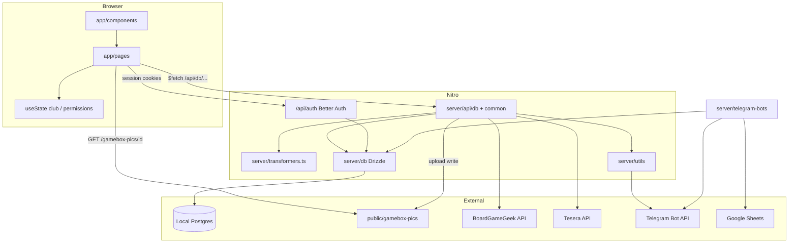

# Architecture

Cartonium (UI: Cartonis) is a Nuxt 4 universal app with Nitro over local Postgres (Drizzle), Better Auth, local static Storage for gamebox pics, plus optional Telegram bots.

## High-level

## Major subsystems

| Subsystem | Responsibility |
|-----------|----------------|
| Club shell | Load club by `url_name`, layout `in-da-club`, permissions |
| Gatherings | Create/list/RSVP sessions; guest counts; TG notify on change/cancel |
| Collection | Browse club games; multi-step add via Tesera/BGG + DB upsert |
| Settings | Club flags, tables CRUD, themes (partial), public HTML info |
| Schedules | User availability grids + history segments |
| Admin | Global gamebox catalog CRUD + picture fetch |
| Auth | Telegram Login Widget / email+password via Better Auth; profiles in Postgres |
| Bots | Blood Bowl votes, Luba quiz, flood-reader stub (not auto-started) |

## Data flow

1. **Club load**: `useUpdateClubData` → `GET /api/db/club-data` → `clubFromDb` → `useState('club')`.
2. **Gatherings list**: `GET /api/db/gatherings` → `gatheringWithGuestsFromDb`.
3. **RSVP**: POST `/api/db/gatherings-set-guest` → upsert guests → `telegramNotify`.
4. **Auth**: TG widget → Better Auth Telegram plugin → session cookie; email via `authClient.signIn.email`.

## State management

No Pinia. Shared keys: `club`, `clubPermissions`, `lastGathering`, `lastGatheringName`. Also Better Auth session, cookie `theme` / `auth-redirect-path`, localStorage `gatherings-view`.

## Routing

- File-based under `app/pages/`.
- Auth-gated: `middleware: auth-required` on information edit + settings; `/admin*` via `club-admin-reroute.global`.

## Server / client boundaries

| Client OK | Server only |
|-----------|-------------|
| `useAuthUser` / Better Auth session | Domain table queries via Drizzle (`#server/db`) |
| Static `/gamebox-pics/*` URLs | BGG/Tesera proxy + XML parse |
| `$fetch` to Nitro | TG HMAC secrets, bot tokens, Google creds |

## External dependencies

- **Local Postgres + Drizzle**: domain + Better Auth tables (`DATABASE_URL`).
- **Better Auth**: sessions, email/password, Telegram plugin.
- **Local filesystem**: `public/gamebox-pics`.
- **BGG / Tesera**, **Telegram**, **Google Sheets** (optional bots).
