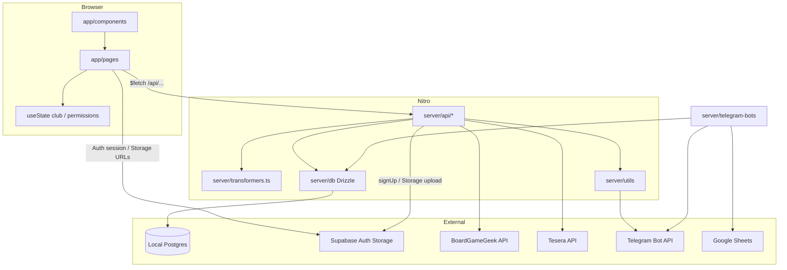

# Architecture

Cartonium (UI: Cartonis) is a Nuxt 4 universal app with Nitro server routes over local Postgres (Drizzle), Supabase Auth/Storage, plus optional Telegram bots.

## High-level

## Major subsystems

| Subsystem | Responsibility |
|-----------|----------------|
| Club shell | Load club by `url_name`, layout `in-da-club`, permissions |
| Gatherings | Create/list/RSVP sessions; guest counts; TG notify on change/cancel |
| Collection | Browse club games; multi-step add via Tesera/BGG + Supabase upsert |
| Settings | Club flags, tables CRUD, themes (partial), public HTML info |
| Schedules | User availability grids + history segments |
| Admin | Global gamebox catalog CRUD + picture fetch |
| Auth | Telegram Login Widget → HMAC → synthetic email/password → Supabase Auth session; profile in local Postgres |
| Bots | Blood Bowl votes, Luba quiz, flood-reader stub (not auto-started) |

## Component relationships

- Club parent `app/pages/clubs/[clubname].vue` validates/loads club → `useState('club')`.
- Feature pages under that tree consume `club` and call `/api/supabase/*`.
- Gathering cards: `table-item.vue` emits join/leave/edit; parents (`table.vue`, list/`[id]`) POST `gatherings-set-guest`.
- Add-games wizard page orchestrates step components under `app/components/pages/add-games/`.

## Data flow

1. **Club load**: page middleware → `useUpdateClubData(clubname)` → `GET /api/supabase/club-data` → `clubFromSupabase` → `useState('club')`.
2. **Gatherings list**: `GET /api/supabase/gatherings` → `gatheringWithGuestsFromSupabase` → UI.
3. **RSVP**: POST `/api/supabase/gatherings-set-guest` → upsert `gatherings_guests` → `telegramNotify`.
4. **Add games**: titles → check exists / in club → Tesera+BGG search → verify → `gamebox-add` + `add-games-to-club`.
5. **Auth**: TG widget → `/auth/telegram-callback` or `/api/common/telegram-callback` → tokens in query → `set-session.global` middleware → Supabase session.

## State management

No Pinia. Shared keys:

- `club` — current club (parent writer)
- `clubPermissions` — `useClubPermissions`
- `lastGathering` / `lastGatheringName` — handoff after create

Also: Supabase Auth user session, cookie `theme`, localStorage `gatherings-view`.

## Routing

- File-based under `app/pages/`.
- Notable: `/` landing; `/confirm` auth callback; `/clubs/:clubname/*` club app; `/admin/*` global admin (middleware + supabase redirect include).
- Supabase redirect include (auth required): information edit, settings, admin. See `nuxt.config.ts`.

## API communication

- Prefixes: `/api/supabase`, `/api/bgg`, `/api/tesera`, `/api/common`.
- Catch-all `server/api/[...].ts` returns `"Hello Nitro"`.
- Client mostly untyped `$fetch`; bodies often snake_case for supabase POSTs.

## Server / client boundaries

| Client OK | Server only |
|-----------|-------------|
| `useSupabaseUser` / session | Domain table queries via Drizzle (`#server/db`) |
| Storage public URLs | BGG/Tesera proxy + XML parse |
| `$fetch` to Nitro | TG HMAC secrets, bot tokens, Google creds |
| UI state | |

## External dependencies

- **Local Postgres + Drizzle**: domain data (`DATABASE_URL`).
- **Supabase**: Auth + Storage (`gamebox-pics`); pgmq path exists but notify queue is usually commented out.
- **BGG / Tesera**: catalog enrichment; BGG calls serialized by `server/plugins/bgg-timeout.ts`.
- **Telegram**: login bot token (`NUXT_BOT_TOKEN`), notify bots, optional feature bots.
- **Google Sheets**: Blood Bowl + Luba bots via `creds.json` / env spreadsheet IDs.
