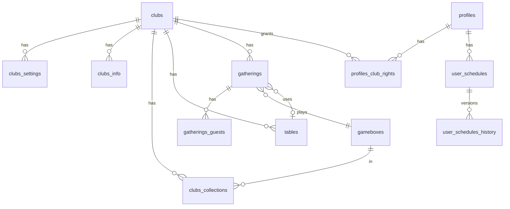

# Data model

Sources of truth:

1. **Schema**: `server/db/schema/` + `server/db/migrations/` (Drizzle → local Postgres)
2. **Legacy reference**: `supabase/migrations/*.sql` (historical cloud dump; do not extend)
3. **UI/domain types**: `shared/types/frontend.ts`
4. **Mapping**: `server/transformers.ts`

Do not invent columns. Field lists below summarize what the app types/migrations expose.

## Entity relationship (app domain)

## Tables

| Table | Role |
|-------|------|
| `gameboxes` | Global catalog (Tesera/BGG ids, titles, ratings, players, playtime) |
| `clubs` | Club identity (`title`, `url_name`) |
| `clubs_collections` | Club ↔ gamebox membership |
| `clubs_info` | Public/about HTML |
| `clubs_settings` | Themes, avatar, guest permissions, collection filter flags, reservation contacts |
| `gatherings` | Scheduled play (owner, club, table, gamebox, guest cap, comments, start) |
| `gatherings_guests` | RSVP rows (guest profile + count) |
| `profiles` | App profile (telegram fields, chat_id, etc.); `id` = Supabase Auth UUID (no FK to `auth.users`) |
| `profiles_club_rights` | `profile_id`, `club_id`, `relation_type` (e.g. `gamemaster`) |
| `tables` | Physical tables at a club |
| `telegram_chats` / `telegram_chats_logs` | Bot chat mappings |
| `user_schedules` / `user_schedules_history` | Named calendars + boolean segment snapshots |
| `telegram_bot_club_bindings` | Schedule bot chat→club |

## Views (local Postgres)

| View | Role |
|------|------|
| `gameboxes_with_club_id` | Gameboxes + array of club ids |
| `gatherings_with_guests` | Upcoming gatherings joined with guests/profiles/gamebox/owner (profiles replace former `auth.users` metadata) |

## Frontend types (camelCase)

Defined in `shared/types/frontend.ts`. Important shapes:

- `Club` — settings flattened onto club for UI
- `GameBox` / `GameBoxWithClub` — catalog card data
- `Gathering` / `GatheringWithGuests` / `GatheringGuest` / `GatheringComputedValue`
- `Table`, `Schedule` / `ScheduleHistoryItem`
- `TelegramNotification` — `{ to, type, why, what, bot_name }`

## Auth identity bridge

Telegram Login → HMAC verify (`NUXT_BOT_TOKEN`) → synthetic email `{telegramId}@tgauth-happens.com` + HMAC password → **Supabase Auth** user. Profile row upserted into **local Postgres** (`profiles`). Session tokens may arrive as `telegram_*_token` query params and are consumed by `app/middleware/set-session.global.ts`.

## Storage

- Bucket usage: `gamebox-pics` on **Supabase Storage** (upload via authenticated Supabase client; public URL helper in `app/utils/gamebox-picture-get.ts`).
