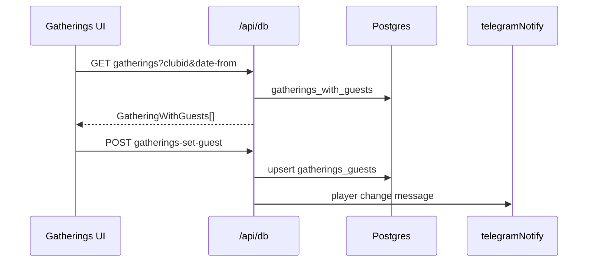

# Feature: Gatherings

## What it does

Club members create play sessions, browse upcoming tables, join/leave with guest counts, and share deep links. Admins get a date-filtered table view. Changes can notify guests via Telegram.

## Where it lives

| Layer | Paths |
|-------|-------|
| Pages | `app/pages/clubs/[clubname]/gatherings/**` |
| Components | `app/components/pages/gatherings/table-item.vue`, `table-item-skeleton.vue` |
| APIs | `server/api/db/gatherings.get.ts`, `gathering.post.ts`, `gathering-find.get.ts`, `gathering-remove.post.ts`, `gatherings-set-guest.ts` |
| Types | `Gathering*`, `GatheringComputedValue` in `shared/types/frontend.ts` |
| Transform | `gatheringFromDb`, `gatheringWithGuestsFromDb` |

Route notes:

- Parent `gatherings.vue` sends guests → `/table`, admins → `/table-admin`.
- Guest list UI: `table.vue` (logic) + `table/list.vue` (cards) + `table/[id].vue` (single + OG).
- Create/edit: `item[[id]].vue`; success: `gathering-accepted.vue` (reads `lastGathering` state).

## Data flow

## Business rules (from code)

- Guest vs admin entry routes differ (`gatherings.vue`).
- Join/leave/add guests gated in UI via `GatheringComputedValue`-style flags on cards.
- Creating a gathering upserts row and inserts host into `gatherings_guests`.
- Remove deletes guests + gathering and notifies (`gathering-removed`).
- View preference stored in `localStorage['gatherings-view']` (`minimal` / `compact` / …).

## Extend safely

- New fields: migration → types → transformers → API → forms/`table-item`.
- Prefer extending parent handlers in `table.vue` over duplicating POST logic in child pages.
- `table-item.vue` is large (multiple view templates) — avoid adding a sixth copy; ask before extract/refactor.
- Keep TG notify message helpers in the API files consistent with existing MarkdownV2 expectations.
